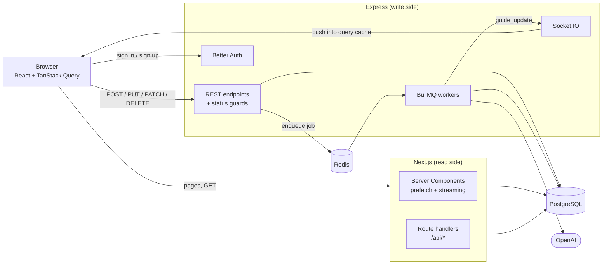
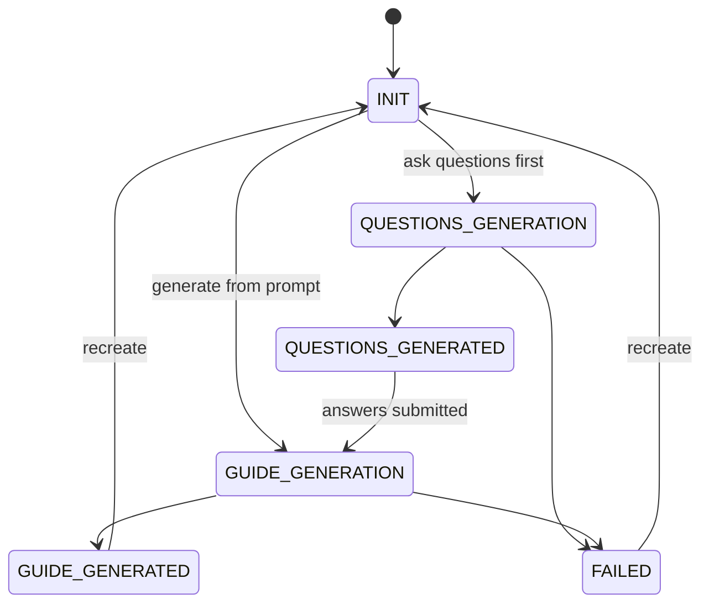
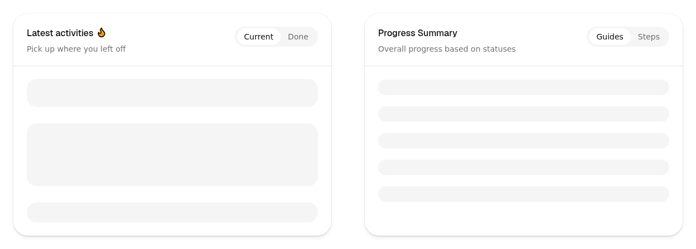
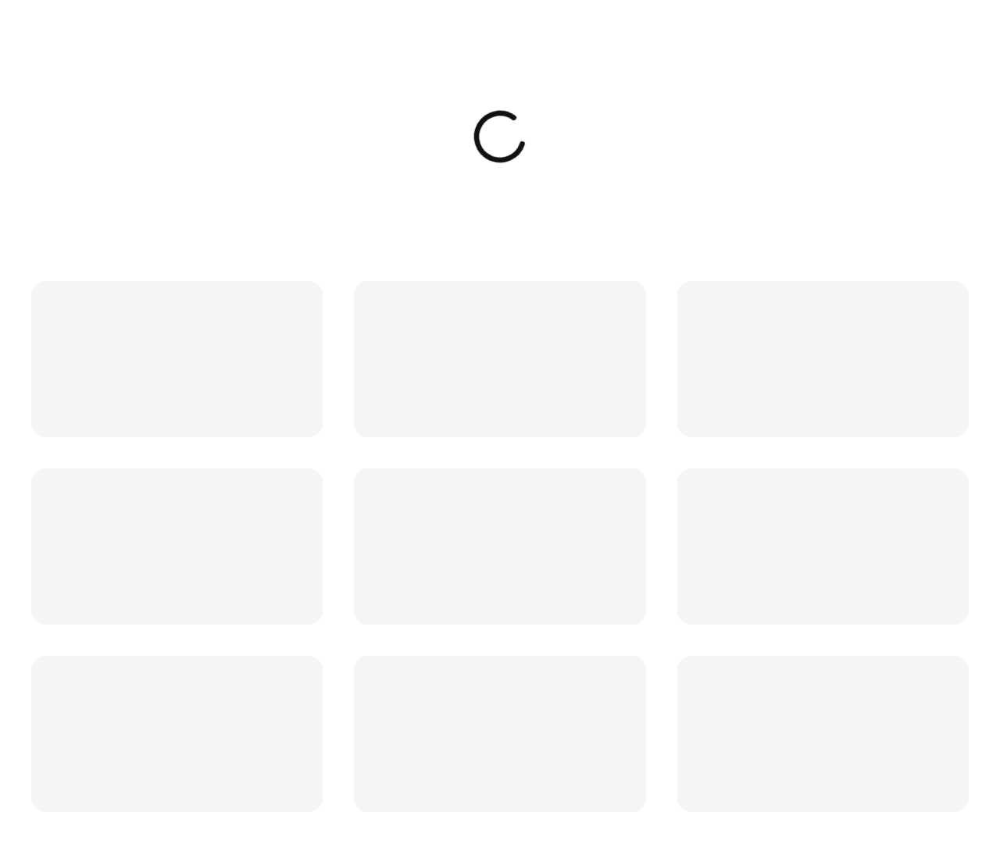
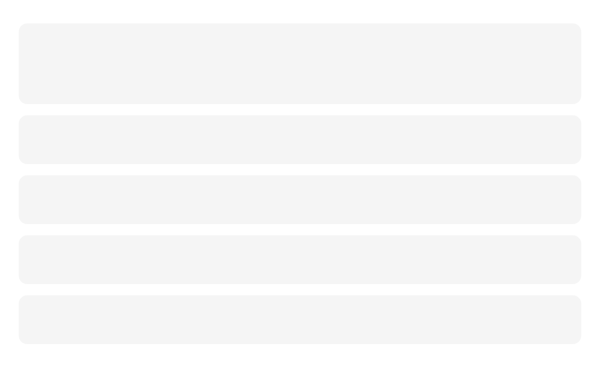
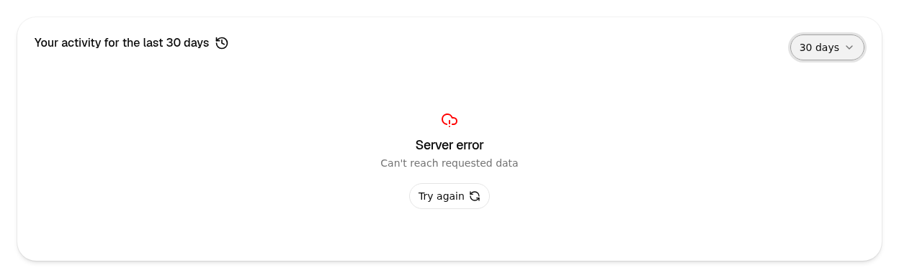
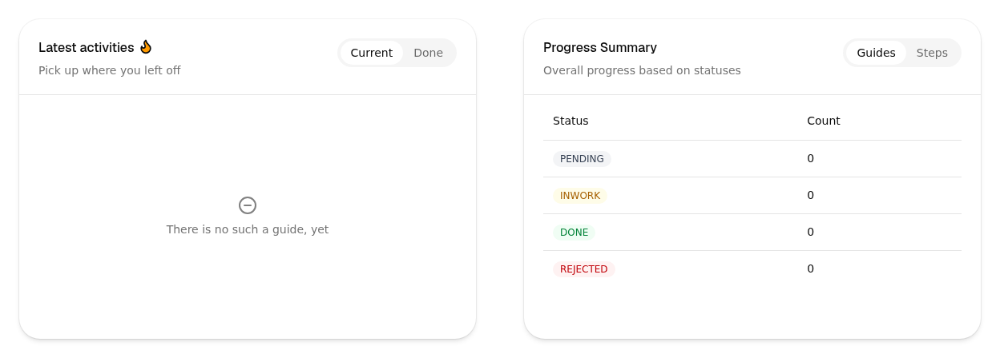

# RoadmapAI

**AI-powered learning roadmaps.** Describe what you want to learn, optionally answer a few clarifying questions, and get a step-by-step guide you can track to completion.

[](https://github.com/d2eight/roadmap/actions/workflows/github-actions.yml)


## Table of contents

- [Features](#features)
- [Demo](#demo)
- [Tech stack](#tech-stack)
- [Architecture](#architecture)
- [Guide lifecycle](#guide-lifecycle)
- [Data fetching strategy](#data-fetching-strategy)
- [UI states](#ui-states)
- [Project structure](#project-structure)
- [Getting started](#getting-started)
- [Testing and CI](#testing-and-ci)
- [Known limitations](#known-limitations)
- [License](#license)

## Features

- **Two ways to create a guide:** generate it from a prompt right away, or let the AI ask clarifying questions first (single choice, multiple choice, range) and build a more personalized guide from your answers.
- **Asynchronous generation:** requests are queued and processed by background workers, so the UI never waits on the LLM.
- **Real-time status updates:** generation progress is pushed to the browser over WebSockets and written straight into the client cache, with no polling.
- **Progress tracking:** mark steps as in progress, done or rejected; the guide's overall progress is derived from its steps.
- **Recreate options:** regenerate a guide, change the questions, change your answers or edit the prompt, including recovery from failed generations.
- **Dashboard:** current and last completed guide, statistics and an activity chart for a selectable period.
- **Filtering, sorting and pagination** of the guides list, driven by URL search params.

## Demo

### Generate a guide from a prompt


### Generate a guide with clarifying questions


### Update step statuses


### Regenerate a guide


### Edit the original prompt


### Change your answers to the AI's questions


### Browse, filter and sort your guides


### Track your overall progress on the dashboard


## Tech stack

| Area | Technologies |
|---|---|
| Monorepo | Nx, TypeScript (strict) |
| Frontend | Next.js 16 (App Router, React Server Components), React 19, TanStack Query, Tailwind CSS 4, shadcn/ui, Recharts, React Hook Form |
| Backend | Express 5, BullMQ, Socket.IO |
| AI | Vercel AI SDK with OpenAI, structured output validated by Zod |
| Data | PostgreSQL, Prisma 7, Redis |
| Auth | Better Auth (email and password, cookie sessions) |
| Validation and errors | Zod schemas shared across frontend, backend and LLM output; `better-result` for errors as values |
| Infrastructure | Docker Compose for Postgres and Redis |

## Architecture



### Read/write separation (lightweight CQRS)

Reads and writes go through different applications that share one database and one set of Prisma models:

- **Reads** are served by Next.js: Server Components query the database directly during SSR, and route handlers serve client-side refetches.
- **Writes** go to Express: every mutation, the job queues, the workers and the WebSocket server live there.

**Why:** SSR reads skip an extra network hop to a separate API, while everything with side effects (queues, LLM calls, real-time events) is isolated in one long-running process.

**Trade-offs:** two deployable apps, auth shared between them (Express issues the session cookie, Next validates it), and a shared domain requirement for cookies. A separate read model would be overkill at this scale, so both sides use the same schema.

### Background generation

1. Express validates the request, checks the guide's current status and enqueues a job. The job ID is the guide ID, so duplicate jobs for the same guide are rejected.
2. A BullMQ worker calls OpenAI with a Zod schema as structured output, so the response is validated before it touches the database.
3. Failed jobs are retried with backoff; after the last attempt the guide is marked `FAILED` and can be recreated.
4. Every status change is emitted over Socket.IO to a room scoped to the user.

### Error handling

Every error response has the same shape, `{ success: false, message }`, so the frontend handles them in one place.

- **Validation:** request bodies are parsed with the shared Zod schemas in middleware; invalid input returns `422`.
- **Auth and ownership:** `401` without a session, `404` when the guide does not exist or belongs to another user.
- **State machine:** `409` when the guide's status does not allow the requested action.
- **Fallbacks:** unknown routes return a JSON `404`, and a global error handler turns malformed JSON into `400` and anything unhandled into `500`.

## Guide lifecycle



Allowed transitions are declared next to each route (`guideMiddleware({ requiredStatuses: [...] })`). A request that does not match the guide's current status gets `409 Conflict`.

On the frontend the guide context is a discriminated union over the status, so each component only sees the fields that exist in that state.

## Data fetching strategy

- **Prefetch on the server without awaiting.** Server Components start queries and pass them, still pending, to the client through `HydrationBoundary`. The page shell renders immediately and each section streams in when its data is ready.
- **`useSuspenseQuery` + `Suspense` + error boundaries per widget.** Loading and error states are isolated: one failing widget does not take down the page, and boundaries reset when filters change.
- **URL as the source of truth for list state.** Filters, sorting and pagination live in search params, which the server parses and validates before rendering.
- **WebSocket events update the cache directly.** A `guide_update` event patches the single-guide query and every cached page of the list (`setQueriesData` with the `['guides']` prefix), so the UI updates without refetching.

## UI states

Every block that loads data has its own loading, error and empty state, so the page never shows a blank area or a stuck spinner.

Each widget is wrapped in the same pair:

```tsx
<QueryErrorBoundary>
    <Suspense fallback={<GuidesLoader />}>
        <GuidesSection />
    </Suspense>
</QueryErrorBoundary>
```

- **Loading:** `Suspense` shows a skeleton with the same layout as the content, so nothing jumps when the data arrives.
- **Error:** `QueryErrorBoundary` combines `react-error-boundary` with React Query's `QueryErrorResetBoundary`. It shows a "Server error" card with a **Try again** button that resets the failed queries and refetches only that widget. The rest of the page keeps working.
- **Empty:** when a request succeeds but returns nothing, the block shows an explanation instead of an empty container.

| Block | Loading | Error | Empty |
|---|---|---|---|
| Guides list | Grid of card skeletons | Error card with retry; resets when filters change | "Not found" with a link to create a guide |
| Guide page | Header and steps skeleton | Error card with retry | "Guide not found" card |
| Dashboard: current / last done guide | Card skeleton | Error card with retry, per tab | "There is no such a guide, yet" |
| Dashboard: progress summary | Table rows skeleton | Error card with retry | — |
| Dashboard: activity chart | Chart-sized skeleton; switching the period keeps the old chart visible (`startTransition`) | Error card with retry | — |

<details open>
<summary><b>Screenshots</b></summary>

**Loading:** skeletons from the server-streamed `Suspense` fallbacks

| Dashboard | Guides list | Guide page |
|---|---|---|
|  |  |  |

**Error:** the activity chart failed, the rest of the dashboard is unaffected



**Empty**

| Dashboard | Guides list | Guide page |
|---|---|---|
|  |  |  |

</details>

Beyond data loading:

- **Generation in progress:** while a job is running, the guide page shows a shimmering placeholder ("Creating …") and the list cards show "Generating a guide / questions" with a spinner. Both switch to the result when the WebSocket event arrives.
- **Generation failed:** the guide shows a failure state with a **Try again** menu that recreates it from the saved prompt and answers.
- **Mutations:** while a form or action is being submitted, its fields are disabled and the content is blurred under a spinner, so it cannot be submitted twice.
- **API errors from actions:** shown as toasts. Validation errors (`422`) are also mapped to the matching form fields, and `401` redirects to sign-in.

## Project structure

```
apps/
  frontend/           Next.js app: pages, route handlers, UI components
  backend/            Express app: REST API, queues, workers, Socket.IO
libs/
  auth/               Better Auth configuration
  db/                 Prisma schema, migrations and generated client/Zod schemas
  env/                Zod-validated environment variables (server and client)
  errors/             Tagged error classes
  shared-constants/   Constants shared by both apps
  shared-types/       Shared types and Zod schemas
  utils/              Shared helpers and database queries
```

## Getting started

### Prerequisites

- Node.js 24
- Docker
- An OpenAI API key

### Setup

```bash
git clone git@github.com:d2eight/roadmap.git
cd roadmap
npm ci

cp .env.example .env    # then set BETTER_AUTH_SECRET and OPENAI_API_KEY
docker compose up -d    # Postgres and Redis
npm run db:migrate      # apply migrations
npm run db:generate     # generate the Prisma client and Zod schemas

npm run dev             # frontend and backend in watch mode
```

- Frontend: http://localhost:4444
- Backend: http://localhost:3333

`.env.example` already contains working local values for Postgres, Redis and the app URLs. Only two values have to be filled in:

| Variable | How to get it |
|---|---|
| `BETTER_AUTH_SECRET` | Any random string of 32+ characters, e.g. `openssl rand -base64 32` |
| `OPENAI_API_KEY` | Your OpenAI API key; `OPENAI_MODEL` selects the model |

### Scripts

| Command | Description |
|---|---|
| `npm run dev` | Run both apps in development mode |
| `npm run build` | Build both apps |
| `npm run lint` | Lint all projects |
| `npm run typecheck` | Type-check both apps |
| `npm run test` | Run unit tests (Jest) |
| `npm run db:migrate` | Create and apply Prisma migrations |
| `npm run db:generate` | Regenerate the Prisma client and Zod schemas |
| `npm run next-types` | Generate Next.js route types (`PageProps`), required before `typecheck` on a fresh clone |

## Testing and CI

Unit tests use Jest via `@nx/jest` and live next to each app in `src/tests`:

- **`defineGuideProgressStatus`** (backend): how a guide's overall status is derived from its steps, including the empty, mixed, all-done and all-rejected cases.
- **`getSearchParamsAndParse`** (frontend): parsing and validation of the guides list URL params, with fallbacks to defaults for missing or invalid `page`, `orderBy` and `status`.

```bash
npm run test
```

Every push runs the GitHub Actions workflow (`.github/workflows/github-actions.yml`) on a clean checkout: `npm ci` → `db:generate` → `next-types` → `typecheck` → `test` → `lint` → `build`. The workflow uses placeholder environment variables, because the Prisma and Next.js configs validate env at load time. No real database or API key is needed.

## Known limitations

Trade-offs I'm aware of and would address next:

- **No rate limiting or usage quotas.** Every generation costs money, so a public deployment would need per-user quotas.
- **Non-atomic status transitions.** The status check and the update are separate queries; an atomic conditional update and a transaction in the worker would close the race window.
- **No recovery for stuck jobs.** If a job is lost after the database write, the guide stays in a generating state. A watchdog that marks stale guides as `FAILED` would fix this.
- **No timeout on LLM calls** and a single worker per queue, so one hanging request blocks the queue.
- **Missed WebSocket events are not replayed** after a reconnect; queries are not invalidated when the connection is restored.
- **Password rules are enforced only on the client**, and there is no email verification.
- **Test coverage is limited to pure logic.** There are no integration tests for the API (Supertest against a test database) and no end-to-end tests.

## License

[MIT](LICENSE)
