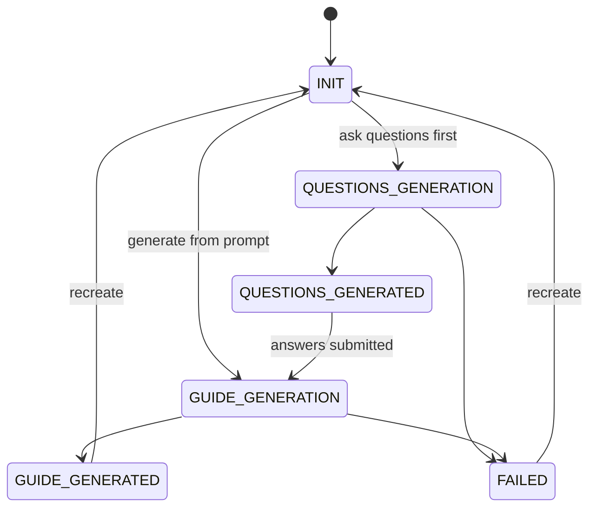

# RoadmapAI

**AI-powered learning roadmaps.** Describe what you want to learn, optionally answer a few clarifying questions, and get a step-by-step guide you can track to completion.

<!-- TODO: CI badge once .github/workflows/ci.yml exists -->

<!-- TODO: hero screenshot or GIF of the dashboard -->

## Table of contents

- [Features](#features)
- [Demo](#demo)
- [Tech stack](#tech-stack)
- [Architecture](#architecture)
- [Guide lifecycle](#guide-lifecycle)
- [Data fetching strategy](#data-fetching-strategy)
- [Project structure](#project-structure)
- [Getting started](#getting-started)
- [Known limitations](#known-limitations)

## Features

- **Two ways to create a guide:** generate it from a prompt right away, or let the AI ask clarifying questions first (single choice, multiple choice, range) and build a more personalized guide from your answers.
- **Asynchronous generation:** requests are queued and processed by background workers, so the UI never waits on the LLM.
- **Real-time status updates:** generation progress is pushed to the browser over WebSockets and written straight into the client cache, with no polling.
- **Progress tracking:** mark steps as in progress, done or rejected; the guide's overall progress is derived from its steps.
- **Recreate options:** regenerate a guide, change the questions, change your answers or edit the prompt, including recovery from failed generations.
- **Dashboard:** current and last completed guide, statistics and an activity chart for a selectable period.
- **Filtering, sorting and pagination** of the guides list, driven by URL search params.

## Demo

<!-- TODO: user flow GIFs
1. Sign up and create a guide from a prompt
2. Guide with clarifying questions
3. Real-time status updates while the guide is generated
4. Tracking progress on steps
5. Dashboard and activity chart
-->

## Tech stack

| Area | Technologies |
|---|---|
| Monorepo | Nx, TypeScript (strict) |
| Frontend | Next.js 16 (App Router, React Server Components), React 19, TanStack Query, Tailwind CSS 4, shadcn/ui, Recharts, React Hook Form |
| Backend | Express 5, BullMQ, Socket.IO |
| AI | Vercel AI SDK with OpenAI, structured output validated by Zod |
| Data | PostgreSQL, Prisma 7, Redis |
| Auth | Better Auth (email and password, cookie sessions) |
| Validation and errors | Zod schemas shared across frontend, backend and LLM output; `better-result` for errors as values |
| Infrastructure | Docker Compose for Postgres and Redis |

## Architecture


### Read/write separation (lightweight CQRS)

Reads and writes go through different applications that share one database and one set of Prisma models:

- **Reads** are served by Next.js: Server Components query the database directly during SSR, and route handlers serve client-side refetches.
- **Writes** go to Express: every mutation, the job queues, the workers and the WebSocket server live there.

**Why:** SSR reads skip an extra network hop to a separate API, while everything with side effects (queues, LLM calls, real-time events) is isolated in one long-running process.

**Trade-offs:** two deployable apps, auth shared between them (Express issues the session cookie, Next validates it), and a shared domain requirement for cookies. A separate read model would be overkill at this scale, so both sides use the same schema.

### Background generation

1. Express validates the request, checks the guide's current status and enqueues a job. The job ID is the guide ID, so duplicate jobs for the same guide are rejected.
2. A BullMQ worker calls OpenAI with a Zod schema as structured output, so the response is validated before it touches the database.
3. Failed jobs are retried with backoff; after the last attempt the guide is marked `FAILED` and can be recreated.
4. Every status change is emitted over Socket.IO to a room scoped to the user.

## Guide lifecycle



Allowed transitions are declared next to each route (`guideMiddleware({ requiredStatuses: [...] })`). A request that does not match the guide's current status gets `409 Conflict`.

On the frontend the guide context is a discriminated union over the status, so each component only sees the fields that exist in that state.

## Data fetching strategy

- **Prefetch on the server without awaiting.** Server Components start queries and pass them, still pending, to the client through `HydrationBoundary`. The page shell renders immediately and each section streams in when its data is ready.
- **`useSuspenseQuery` + `Suspense` + error boundaries per widget.** Loading and error states are isolated: one failing widget does not take down the page, and boundaries reset when filters change.
- **URL as the source of truth for list state.** Filters, sorting and pagination live in search params, which the server parses and validates before rendering.
- **WebSocket events update the cache directly.** A `guide_update` event patches the single-guide query and every cached page of the list (`setQueriesData` with the `['guides']` prefix), so the UI updates without refetching.

## Project structure

```
apps/
  frontend/           Next.js app: pages, route handlers, UI components
  backend/            Express app: REST API, queues, workers, Socket.IO
libs/
  auth/               Better Auth configuration
  db/                 Prisma schema, migrations and generated client/Zod schemas
  env/                Zod-validated environment variables (server and client)
  errors/             Tagged error classes
  shared-constants/   Constants shared by both apps
  shared-types/       Shared types and Zod schemas
  utils/              Shared helpers and database queries
```

## Getting started

### Prerequisites

- Node.js 24
- Docker
- An OpenAI API key

### Setup

```bash
git clone git@github.com:d2eight/roadmap.git
cd roadmap
npm ci

cp .env.example .env              # fill in the values
docker compose up -d              # Postgres and Redis
npx prisma migrate dev --config libs/db/prisma.config.ts

npx nx run-many -t dev
```

- Frontend: http://localhost:4444
- Backend: http://localhost:3333

<!-- TODO: describe each variable in .env.example or give local defaults there -->

## Known limitations

Trade-offs I'm aware of and would address next:

- **No rate limiting or usage quotas.** Every generation costs money, so a public deployment would need per-user quotas.
- **Non-atomic status transitions.** The status check and the update are separate queries; an atomic conditional update and a transaction in the worker would close the race window.
- **No recovery for stuck jobs.** If a job is lost after the database write, the guide stays in a generating state. A watchdog that marks stale guides as `FAILED` would fix this.
- **No timeout on LLM calls** and a single worker per queue, so one hanging request blocks the queue.
- **Missed WebSocket events are not replayed** after a reconnect; queries are not invalidated when the connection is restored.
- **Password rules are enforced only on the client**, and there is no email verification.
- **Inconsistent API error format** across endpoints.
- <!-- TODO: tests -->

<!-- TODO: License -->
